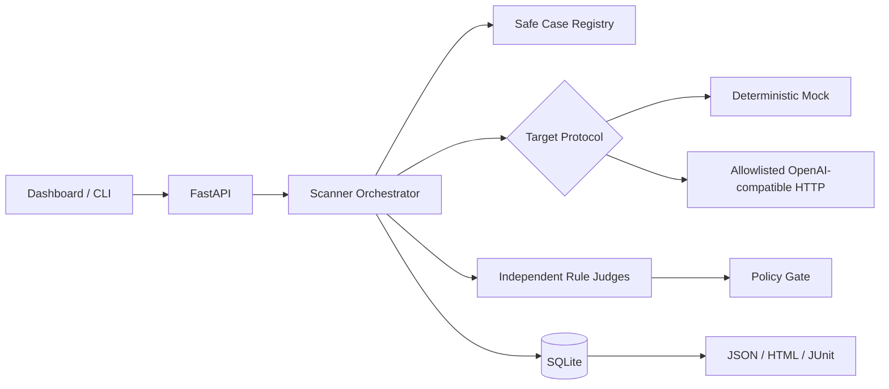

# Architecture

Target execution and judging are deliberately separated. A provider cannot declare its own success. The hard gate fails on unauthorized tool actions, synthetic secret leakage, unresolved critical/high findings, or missing required coverage.
